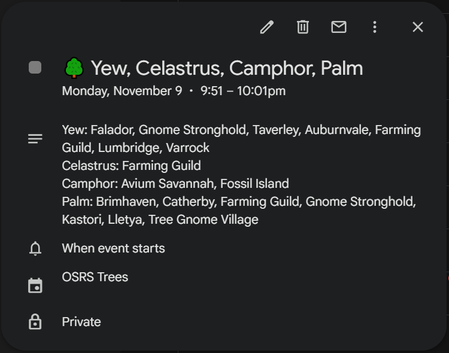

# Tree Pings

**Get a calendar notification on your phone when it's time to do a tree run. Even with your PC off.**

Tree Pings turns your tree timers into **events on your Google Calendar**. Each event starts
the moment your trees are ready and has a notification set for that time, so your phone
shows an ordinary Google Calendar notification, just like a meeting reminder.

- No new app on your phone. It uses the Google Calendar app.
- The events go on their own private calendar, **OSRS timers**, separate from your real one.
- No 3 AM notifications. Anything that finishes overnight waits for one morning event (can be changed in settings)
- About ~2 events a day, trees are batched for efficient runs.
- **Exact times when on PC, fuzzy matching on mobile runs.** RuneLite can't see what you do on mobile, so
  after a mobile run Tree Pings assumes you replanted when it reminded you and keeps the
  reminders coming. Log in on PC now and then and they snap back to your exact timers.

---

## What you'll see

On a normal day, your **OSRS timers** calendar has events like these. Each one is a short
event at the time shown, and its notification uses the event title:

| Time | Calendar event (and notification) | Inside the event |
| --- | --- | --- |
| 8:00 AM | **🌳 Yew, Palm, Calquat** | Yew: Falador, Lumbridge, Varrock… Palm: Brimhaven, Catherby… Calquat: Kastori, Tai Bwo Wannai |
| 2:40 PM | **🌳 Yew** | Yew (if replanted): Falador, Lumbridge, Varrock… |

- **Your regular trees (yews, magics, etc.) decide when events are created.** Fruit trees,
  calquats and hardwoods don't get events of their own. They're listed on the next
  regular-tree event instead.
- **After a mobile run, the times are a best guess.** RuneLite can't see mobile, so Tree
  Pings assumes you replanted when it reminded you and keeps a daily rhythm going for 5 days.
  These events say "(if replanted)". If you ran late or skipped a run, the guess is off until
  RuneLite next sees the patch on PC, and then the real timer takes over.
- **Titles are just the trees.** The calendar already shows the time, and after mobile runs
  RuneLite can't know which patches you did, so there are no counts. Tap an event for the
  patch list.
- **The calendar keeps itself tidy.** Every update replaces upcoming Tree Pings events with
  the current plan, and events older than 12 hours are deleted.
- **Events are private** and only ever written to the OSRS timers calendar. Your other
  calendars aren't touched.

---

## How it works

1. **You farm like normal, on PC or mobile.** On PC, Tree Pings reads the timers RuneLite's
   Time Tracking plugin already keeps. It doesn't touch the game.
2. **When your run is done, it updates your calendar.** A few minutes after your last patch
   (or right away when you log out), chat says:
   > Tree Pings: calendar updated. Next ding: 🌳 Yew at 2:40 PM.
3. **At that time, your phone shows a Google Calendar notification.** It works the same
   whether your PC is on, off, or asleep, because the events now live in Google Calendar.
   Tap the notification to open the event and see which patches it's for.

---

## Setup (about 3 minutes, once)

You need a Google account and the Google Calendar app on your phone. Install **Tree Pings**
from RuneLite's Plugin Hub first.

### 1. Get your own copy of the script

The script lives in **your own** Google account. It's the thing that writes to your calendar.

1. Open **[the Tree Pings script](https://script.google.com/d/1sDLFpKl0nzbDjGBqqHxnH1PVNPpTsI0ekrgv96VX_rL39DK4JuevPp4u/edit)**
   (sign in to Google if it asks).
2. Click ⓘ **Overview** at the top of the left sidebar, then the **Make a copy** icon (two
   overlapping pages, next to the star) at the top right.
   You're now in your own copy, called "Copy of OSRS Tree Pings".

*No copy button? Go to [script.google.com](https://script.google.com) → **New project**, delete
everything in the editor, paste in [this code](apps-script/Code.gs) and click 💾 **Save**.*

### 2. Deploy it

1. Click **Deploy** (top right) → **New deployment**.
2. Click the ⚙️ next to "Select type" → **Web app**.
3. Set **Execute as:** Me and **Who has access:** Anyone, then click **Deploy**.
4. Google asks for permission. Click **Authorize access** and pick your account. It says
   **"Google hasn't verified this app."** That's normal: it's your own script. Click
   **Advanced** → **Go to (your project) (unsafe)** → **Allow**.
5. **Copy the Web app URL.** It ends in `/exec`.

> "Anyone" just means the plugin can reach the script. The first time the plugin connects, the
> script locks itself to that plugin and ignores everyone else.

### 3. Paste the URL into Tree Pings

In RuneLite, open the Tree Pings settings (🔧 wrench → search "Tree Pings") and paste the URL
into **Script URL**. Chat says *"Tree Pings: connected."*

### 4. Check your phone

About 2 minutes later your phone shows a Google Calendar notification called
"Tree Pings test ding". **You're done.** Farm like normal.

**Didn't get it?** The plugin is fine if chat said "connected"; this is a phone setting:
- Open the **Google Calendar** app → ☰ menu → make sure **OSRS timers** is ticked.
- **Android:** phone Settings → Accounts → your Google account → Account sync → turn on **OSRS timers**.
- **iPhone:** use the Google Calendar app (not Apple's Calendar) and allow its notifications in iPhone Settings.
- Check that Do Not Disturb isn't on, then tick **Send test ding** in the plugin settings to try again.

---

## Privacy

- Your tree times go to **your own** Google script and **your own** calendar. Nothing else.
- The events are marked **private**.
- The script only listens to the plugin that connected to it first, and ignores everything else.
- Keep your Script URL to yourself.

---

## Day to day

- **When you log in,** chat tells you when your next notification is.
- **You can close RuneLite any time** after a run. The events are already on your calendar.
- **Did a run on mobile?** Nothing to do. The estimated rhythm covers it, for days at a time.
- **Want exact times again after mobile runs?** Walk past any one patch of each kind on PC (the
  Farming Guild has most kinds). If RuneLite sees one tree of a kind freshly planted, every patch
  of that kind it still thinks is "Done" gets the same timer.
  Next time you play on PC, everything updates.

---

## Something wrong?

Tree Pings tells you in chat when something goes wrong:

| Chat says | Do this |
| --- | --- |
| "not set up yet" | Follow the setup steps above and paste your Script URL in the plugin settings. |
| "(bad token)" | The script is linked to a different RuneLite install. In the script, open ⚙️ **Project Settings**, delete `TOKEN` under **Script properties**, then paste the Script URL into the plugin again. |
| "(HTTP …)" or "unexpected reply" | Check the URL ends in `/exec`, and the deployment's **Who has access** is **Anyone**. |
| "(couldn't reach Google)" | Internet problem. It keeps trying on its own. |
| "N trees can't be timed yet" | RuneLite is still learning the farming clock. Stand near a growing tree until it grows a stage. |
| "Time Tracking plugin is turned off" | Turn RuneLite's built-in **Time Tracking** plugin back on. |

**Events are on the calendar but no notification shows up?** That's a phone setting.
See "Didn't get it?" in setup step 4.

**Good to know:**
- RuneLite only knows what it last saw. If you skip a run, the rhythm assumes you didn't and keeps reminding you on schedule; log in on PC to resync.
- A patch RuneLite hasn't seen finish for 2 weeks is treated as abandoned and gets no more reminders until you visit it again.
- If a tree gets diseased while you're away, you still get its notification at the normal time.
- Use one RuneScape account per calendar. Each account would overwrite the other's events.
- You can rename the calendar or change its colour. Don't delete it.

---

## FAQ

**Why do I need my own Google script?**
The RL plugin can't write to your calendar directly, so it sends your tree times to a small
script in your own Google account, and the script updates your calendar. There is no Tree
Pings server and no account to create.

**Google says "this app isn't verified". Is that a problem?**
No. Google shows that warning for any personal script it hasn't reviewed. The script is your
own copy, running in your own account, and you can read all of it in `apps-script/Code.gs`.

**Does it cost anything?**
No! Google Apps Script and Google Calendar are free.

**Why Google Calendar?**
I built this for myself, and Google Calendar is what I use. I'm not sure if this would work on any other calendar, if Apple calendar has a google scripts equivalent, for example.

**How does it know about runs I do on mobile?**
It doesn't...RuneLite can't see mobile play, so the plugin assumes you replanted at the time
of each reminder and schedules the next ones from there. The times are corrected the next
time RuneLite sees the patch on PC.

**A reminder said my trees were ready and they weren't. Why?**
That reminder was one of those assumed times (the event says "if replanted"), and you
planted later than it assumed or skipped a run.

**My fruit trees (or calquats, celastrus, hardwoods) finished hours ago and I got no notification. Is it broken?**
No. Only regular trees (oak, willow, maple, yew, magic) create notifications. Other trees
that finish within 45 minutes of a regular-tree notification are included in it. Ones that
finish later than that are listed on your next regular-tree notification, which can be
several hours later, or the next morning. If you have no regular trees growing, the other
trees get their own notifications.

**Why don't I get a notification for each tree?**
Trees that finish within 45 minutes of each other are batched in one cal event. Fruit trees,
calquats, celastrus and hardwoods don't get their own: they are listed on the next
regular-tree notification.

**Why are there no notifications at night?**
Anything that finishes outside your awake hours waits until the hour you wake up. You can
change the hours in the settings, or set both to the same hour to turn this off.

**Why does the calendar update a few minutes after my run?**
The plugin waits until you haven't changed a patch for 5 minutes, so it doesn't send a run
that's still in progress. Logging out or closing RuneLite sends it immediately.

**Why do the titles have no patch counts?**
After a mobile run the plugin doesn't know how many patches you did, so the counts were
often wrong. The patch list is inside the event, but I prefered to see "do your yews" rather than "do your 6x yews", because the first one is usually always right, and the number could often be wrong (even though all your trees are usually done at the same time)

**Why only trees?**
Trees are all I wanted reminders for. Herbs and allotments could be added, but I haven't
needed them.

---

## Settings

Most people only need the Script URL.

| Setting | What it does |
| --- | --- |
| **Open setup guide** | Tick it to open the setup steps above in your browser. |
| **Script URL** | The Web app URL from setup step 2. Pasting it connects the plugin and sends a test ding. |
| **Send test ding** | Tick it to put a test event on your calendar. Your phone gets its notification 2 minutes later. |
| **Awake from / until** | Your waking hours (24-hour clock). Default 8 to 0 (8 AM to midnight). Anything finishing while you sleep waits for one morning event. Set both the same to get notifications around the clock. |
| **Follow-on runs** | Runs a day after your morning run. Default 1 (morning + afternoon). Set 2 for three runs a day, or 0 if you only farm on PC and want reminders only for what RuneLite has seen. |
| **Chat messages** | The "next ding" messages in chat. Problems always show, even if this is off. |
| *Advanced* | Sync delay, group window and "only belled patches". You don't need to touch these. |

---

## For developers

Build and run locally with `./gradlew run` (JDK 11+).

The `farming` folder contains code copied from RuneLite's Time Tracking plugin (BSD 2-Clause
License, see `NOTICE`), because RuneLite doesn't make those classes public. Tree Pings only
reads Time Tracking's saved data and never changes it.
